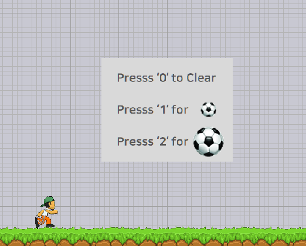

main.py에서 구동 되는 게임 구조 활성화

목표: play_mode에서 작동하는 아이템 창 및 아이템 모드 등을 구성해라.

구성 예시는 하단의 이미지를 참고 한다

구현 기능: 

1.아이템 창 모드는 I키 토글 형태로 들어간다 (재 입력시 종료)

2. 아이템 창모드에 진입 했을때 게임 캐릭터 동작은 정지 상태여야 한다
3. 0번 키를 눌렀을때 기존 게임 루프로 돌아가던 space 기능(space 키를 누르면 공을 찬다)에서 공이 나가지 않게 된다
4. 1번 키를 눌렀을때 기존 게임 루프로 돌아가던 space 기능에서(공사이즈를 ball21x21.png 크기에 공이 출력된다)
5. 2번 키를 눌렀을때 기존 게임 루프로 돌아가던 space 기능에서(공사이즈를 ball41x41.png 크기에 공이 출력된다)
6. 아이템 창모드에선 각 기능(0~2)을 한번 누르면 바로 아이템 창이 사라지고,  효과가 게임 모드에서 정상 작동 되어야 한다

그외 추가 요구 사항:

1.모든 개발은 점진적 개발 환경을 목표로 한다, 각 단계마다 커밋을 작성한다.(커밋의 양은 적절히 진행해야 한다)

2. 모든 커밋은 한글로 작성한다.
